# 🌍 Multi-Language Sentiment Analysis System

[](https://github.com/ITPainter/sentiment-analysis-multi-language/actions/workflows/tests.yml)

A Python system that auto-detects Korean, Chinese, English, and Japanese text, runs sentiment analysis (positive/neutral/negative), and produces Excel results with visualizations.

## Features
- Automatic language detection (KO/ZH/EN/JA), or force one with `--lang`
- Excel I/O, batch processing per sheet
- Language-optimized pretrained models, each with an alternative + fallback model, loaded lazily (only the languages your file actually uses)
- Bar, pie, wordcloud, confidence histogram, and cross-language comparison charts
- Cross-platform wordcloud fonts (macOS / Windows / Linux)
- Google Colab notebooks included

## Architecture



## Quick Start
```bash
python -m venv venv
source venv/bin/activate      # Windows: venv\Scripts\activate
pip install -r requirements.txt

cd src
python main.py                # create sample data and run analysis
python main.py your_data.xlsx # analyze an Excel file from output/
python main.py your_data.xlsx --lang k   # skip detection, force Korean
python main.py --help
```

Or install it as a CLI tool:
```bash
pip install -e .
sentiment-analysis your_data.xlsx
```

## Project Structure
```
src/
├── main.py            # entry point
├── core_config.py     # config (models, processing parameters, etc.)
├── core_models.py     # model loading / inference
├── core_language.py   # language detection
├── data_excel.py      # Excel I/O
├── data_charts.py     # visualization
├── data_sample.py     # sample data generation
└── colab/             # per-language Colab notebooks
tests/                  # pytest suite (no model downloads required)
output/                 # generated results — not tracked in git
├── korea/ china/ english/ japan/   # results by language
├── logs/ cache/                    # logs, model cache
architecture.html, architecture.svg   # architecture diagram source + export
```

## Models by Language

| Language | Code | Primary | Alternative | Fallback |
|------|------|---------|-------------|----------|
| 🇰🇷 Korean | `k` | snunlp/KR-FinBert-SC | sangrimlee/bert-base-multilingual-cased-nsmc | matthewburke/korean_sentiment |
| 🇨🇳 Chinese | `c` | IDEA-CCNL/Erlangshen-Roberta-110M-Sentiment | uer/roberta-base-finetuned-dianping-chinese | uer/roberta-base-finetuned-jd-binary-chinese |
| 🇺🇸 English | `e` | cardiffnlp/twitter-roberta-base-sentiment-latest | finiteautomata/bertweet-base-sentiment-analysis | distilbert-base-uncased-finetuned-sst-2-english |
| 🇯🇵 Japanese | `j` | christian-phu/bert-finetuned-japanese-sentiment | koheiduck/bert-japanese-finetuned-sentiment | jarvisx17/japanese-sentiment-analysis |

Falls back automatically primary → alternative → fallback on load failure. Each model is downloaded from the Hugging Face Hub under its own license, separate from this repo's license. Edit models/parameters in `src/core_config.py`.

## Testing

```bash
pip install -e ".[dev]"
pytest
```

The test suite covers language detection, label mapping, column detection, and chart aggregation — none of it downloads a model, so it runs fully offline and is used in CI (`.github/workflows/tests.yml`) across Linux, macOS, and Windows.

## Requirements
- Python 3.9+ (tested on 3.11)
- Internet connection required for model download on first run
- GPU: auto-detects CUDA or Apple Silicon (MPS), otherwise CPU
- See `requirements.txt` for dependency versions

## License
[MIT](LICENSE)

Contact: gangdung@gmail.com
